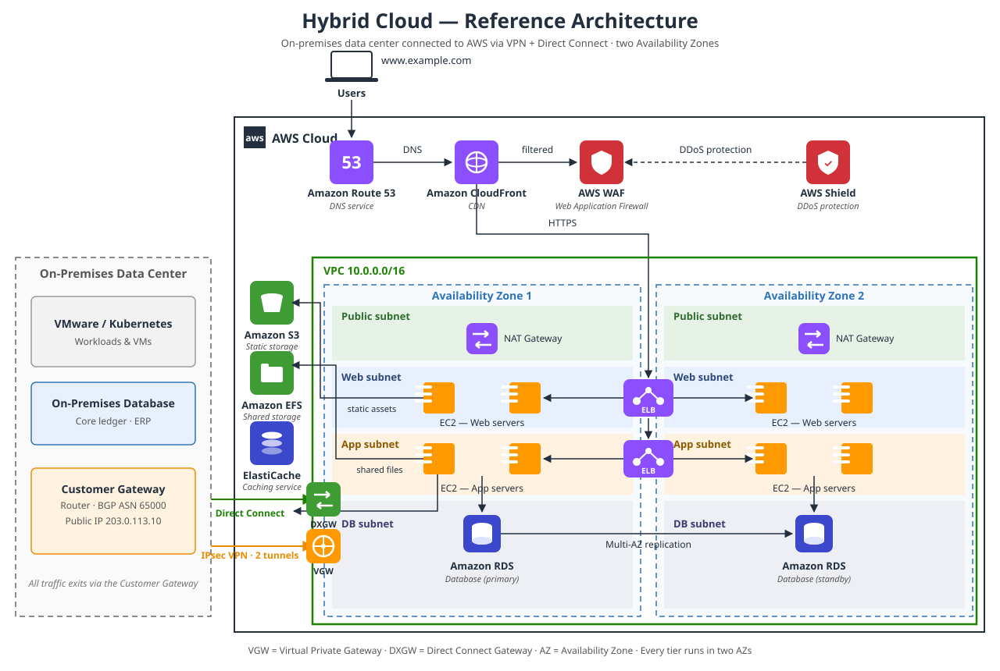
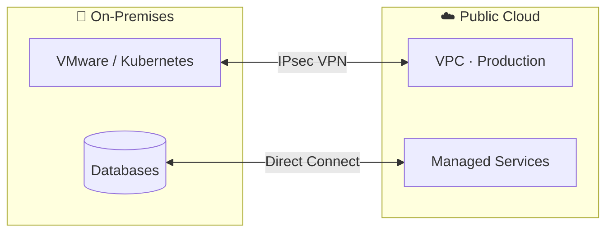

# 🌐 Hybrid Cloud — The Complete Guide


> [!TIP]
> **TL;DR** — Hybrid cloud = your on-premises data center + one or more public clouds, wired together so workloads move freely. Keep sensitive stuff close, burst to the cloud when you need scale. Best of both worlds — *if* you design the network, routing, and identity right. This guide explains every piece in plain words first, then shows the real engineering underneath.

## Table of contents

- [1. What "hybrid" actually means](#1-what-hybrid-actually-means)
- [2. Architecture](#2-architecture)
- [3. How each component works](#3-how-each-component-works)
- [4. Public vs Private vs Hybrid](#4-public-vs-private-vs-hybrid)
- [5. How the two worlds connect](#5-how-the-two-worlds-connect)
- [6. Routing & BGP — how traffic finds its way](#6-routing--bgp--how-traffic-finds-its-way)
- [7. The 3 hybrid patterns you'll meet in interviews](#7-the-3-hybrid-patterns-youll-meet-in-interviews)
- [8. One identity everywhere](#8-one-identity-everywhere)
- [9. Code walkthrough](#9-code-walkthrough)
- [10. Best practices](#10-best-practices)
- [11. Troubleshooting](#11-troubleshooting)
- [12. Cost notes](#12-cost-notes)
- [13. When hybrid wins — and when it doesn't](#13-when-hybrid-wins--and-when-it-doesnt)
- [14. Watch & go deeper](#14-watch--go-deeper)

---

## 1. What "hybrid" actually means

Forget the marketing slides. Hybrid cloud is simply this: **two (or more) environments that behave like one**. Your apps don't care whether they run on a rack in Jakarta or in an AWS region in Singapore — the network, identity, and tooling make it feel like a single platform.

Think of it like a house with a home office: you do focused work at home (on-prem: control, low latency, compliance), but when you throw a party for 200 people, you rent the venue next door (public cloud: elastic scale). Same life, different rooms.

The keyword is **integration**. A company that runs AWS *and* owns a data center is not automatically "hybrid". Hybrid means the two sides are connected and workloads can actually move between them — shared network, shared identity, shared deployment pipelines. Two disconnected silos with a VPN nobody monitors are just... two silos.

---

## 2. Architecture



**Traffic flow, left to right:**

1. **Users** hit `www.example.com` → **Route 53** resolves the name.
2. **CloudFront (CDN)** serves static content from the edge; dynamic requests pass through **WAF** (web firewall) and **Shield** (DDoS protection).
3. Requests land on the **Application Load Balancer** in the public subnets, which spreads them across **EC2 web servers** in two Availability Zones.
4. Web servers call **EC2 app servers** in the app subnets; app servers read/write **RDS (primary in AZ-1, standby in AZ-2)** and cache hot data in **ElastiCache**.
5. Static files and backups live in **S3**; shared files in **EFS**.
6. The whole VPC talks back to the **on-premises data center** over two paths: an **IPsec VPN** (fast to set up) and a **Direct Connect** private fiber link (for steady production traffic).

---

## 3. How each component works

Every component below is explained twice: first in one plain sentence, then in the engineering detail.

| Component | Plain words | What it really does |
|---|---|---|
| **On-premises data center** | Your own server room — the "home office". | Racks, VMware/Kubernetes, databases you physically own. Full control, fixed capacity. |
| **Customer Gateway (CGW)** | The router at your office door that speaks VPN. | Your on-prem router/firewall with a public IP and a BGP ASN; the AWS side of the tunnel terminates here. |
| **Virtual Private Gateway (VGW)** | AWS's side of the tunnel door. | Attached to the VPC; terminates IPsec tunnels and advertises routes into the VPC route tables. |
| **Site-to-Site VPN** | An encrypted tunnel through the public internet. | Two IPsec tunnels (for redundancy) between CGW and VGW. ~1.25 Gbps per tunnel, setup in hours. |
| **Direct Connect (DX)** | A private fiber cable straight into AWS — no internet in the path. | 1–100 Gbps dedicated connection from your DC (or a DX location) into AWS. Consistent latency, setup in weeks. |
| **Direct Connect Gateway** | The junction box that lets one DX link reach many VPCs. | Associates a DX connection with multiple VPCs (even across regions) via virtual private gateways. |
| **Transit Gateway** | The central airport hub for all your networks. | One hub that connects VPCs, VPNs, and DX links; route tables decide which network can talk to which. Scales far better than VPC peering spaghetti. |
| **Route 53** | The phone book of the internet. | Managed DNS: turns `www.example.com` into an IP, with health checks and failover between regions. |
| **CloudFront** | Copies of your content stored near your users. | Global CDN: caches static assets at edge locations so a user in Jakarta doesn't wait for a server in Virginia. |
| **WAF** | A bouncer that checks every web request against a rule list. | Blocks SQL injection, XSS, and bad bots before they reach your app. |
| **Shield** | The security guard against DDoS floods. | Standard (free, always on) absorbs common attacks; Advanced adds 24/7 response and cost protection. |
| **Application Load Balancer** | The receptionist who sends each visitor to a free desk. | Layer-7 load balancing across AZs, TLS termination, path/host-based routing to target groups. |
| **EC2 (web / app tiers)** | Rented computers you can start and stop in minutes. | Web tier serves HTTP; app tier runs business logic. Auto Scaling Groups add/remove instances by demand. |
| **RDS** | A database you don't have to babysit. | Managed PostgreSQL/MySQL: automated backups, patching, and Multi-AZ failover (standby in AZ-2). |
| **ElastiCache** | A sticky note on the fridge — fast answers for repeated questions. | In-memory Redis/Memcached cache in front of RDS; cuts database load and latency for hot data. |
| **S3** | An (almost) infinite hard drive in the cloud. | Object storage for static files, backups, and data lakes. 11 nines of durability. |
| **EFS** | A shared folder every server can open at once. | NFS file system mountable from many EC2 instances across AZs — unlike EBS, which attaches to one. |

---

## 4. Public vs Private vs Hybrid

| | 🌍 Public Cloud | 🏢 Private Cloud | 🌐 Hybrid Cloud |
|---|---|---|---|
| **Where it runs** | Provider's data centers | Your data center | Both, connected |
| **Scaling** | Near-infinite, on demand | Limited by hardware you own | Burst to cloud when needed |
| **Cost model** | Pay-as-you-go (OpEx) | Upfront hardware (CapEx) | Mix — optimize per workload |
| **Control** | Shared responsibility | Full control | Full control where it matters |
| **Best for** | Startups, spiky traffic | Regulated data, steady loads | Everyone in between |

---

## 5. How the two worlds connect

### Option A — IPsec VPN (the quick way)

Encrypted tunnel over the public internet. Cheap, set up in an afternoon, ~1.25 Gbps per tunnel. Perfect for dev environments, backups, and "let's try hybrid this sprint."

### Option B — Dedicated interconnect (the serious way)

Private fiber straight into the cloud provider: **AWS Direct Connect**, **Azure ExpressRoute**, **Google Cloud Interconnect**. Consistent latency, up to 100 Gbps, no internet in the path. This is what production hybrid runs on.

| | IPsec VPN | Dedicated Interconnect |
|---|---|---|
| Bandwidth | Up to ~1.25 Gbps per tunnel | 1–100 Gbps |
| Latency | Varies (internet) | Consistent & low |
| Setup time | Hours | Weeks (physical circuit) |
| Cost | Pennies | Real money |
| Best for | Pilots, dev, backup traffic | Production, steady heavy traffic |

**In practice, run both.** VPN as the cheap backup path, Direct Connect as the primary — if the fiber is ever cut, traffic fails over to the VPN automatically (BGP handles this, see §6).

> [!NOTE]
> `vpn.tf` in this repo spins up an AWS Site-to-Site VPN in ~30 lines of Terraform, with optional dynamic BGP routing and a CloudWatch alarm that pages you when a tunnel goes down. `direct-connect.tf` shows the Direct Connect side: a DX Gateway with a private virtual interface and route propagation.

---

## 6. Routing & BGP — how traffic finds its way

**Plain words:** BGP (Border Gateway Protocol) is the GPS of the internet. Each network constantly tells its neighbours "I can reach these addresses, and it costs me this much." If a road closes, the GPS recalculates and picks the next-best route — automatically.

In a hybrid setup that means:

- **Static routing** (`static_routes_only = true` in `vpn.tf`) is like a printed map: you write the routes by hand. Simple, fine for one tunnel — but if the tunnel dies, nobody redraws the map.
- **Dynamic routing (BGP)** is the live GPS: the customer gateway and the virtual private gateway exchange routes continuously. Add a new subnet on-prem and AWS learns it. A tunnel goes down and traffic shifts to the healthy path in seconds.

**Three rules that save you from 2 AM pages:**

1. **Never overlap CIDRs.** Your VPC (`10.0.0.0/16`) and your data center (`192.168.0.0/16`) must not share address space — overlapping ranges make routing ambiguous and packets go nowhere.
2. **Propagate, don't hand-write.** Let the VGW propagate routes into your VPC route tables instead of maintaining static entries by hand.
3. **Test failover before you need it.** Kill one tunnel on purpose during a maintenance window and watch traffic move. If you first discover failover is broken during a real outage, it's already too late.

---

## 7. The 3 hybrid patterns you'll meet in interviews

1. **☁️ Cloud bursting** — Base load runs on-prem; traffic spikes overflow to the cloud. E-commerce on 11.11, tax season, ticket launches.
2. **💾 Backup & disaster recovery** — On-prem stays primary; the cloud holds replicas and takes over if the data center goes dark. Cheap insurance.
3. **🧲 Data gravity** — Keep heavy data where it lives (on-prem databases, edge devices) and push only compute or analytics to the cloud.



---

## 8. One identity everywhere

> [!WARNING]
> The #1 hybrid anti-pattern: connecting the networks but not the **identity, monitoring, and deployment pipelines**. Two dashboards, two logins, two ways to deploy = twice the pain, zero benefit.

What "one identity" looks like in practice:

- **Single sign-on (SSO):** one corporate identity (e.g. via IAM Identity Center / Active Directory) that logs you into both the data center and AWS — no separate cloud passwords floating around.
- **Same roles, same rules:** an engineer who can deploy on-prem can deploy in the cloud with the same approval flow, enforced by IAM roles and SCPs.
- **One audit trail:** CloudTrail in AWS + your on-prem logs shipped to the same SIEM, so an incident investigation doesn't stop at the network boundary.
- **Secrets in one place:** database passwords and API keys live in Secrets Manager / Parameter Store, rotated automatically — never hardcoded in Terraform or checked into git.

---

## 9. Code walkthrough

### `vpn.tf` — Site-to-Site VPN (static or BGP)

```hcl
resource "aws_vpn_connection" "hybrid" {
  vpn_gateway_id      = aws_vpn_gateway.this.id
  customer_gateway_id = aws_customer_gateway.datacenter.id
  type                = "ipsec.1"
  static_routes_only  = true
  tags                = { Name = "hybrid-tunnel" }
}
```

Set `enable_bgp = true` (and `static_routes_only = false`) to switch from hand-written routes to dynamic BGP — see the commented section in the file. The file also creates a **CloudWatch alarm** on `TunnelState`: if either tunnel drops, you get notified instead of finding out from users.

**Deploy it:**

```bash
terraform init
terraform apply -var="onprem_public_ip=203.0.113.10"
# After apply, check the output: both tunnels should be UP.
```

### `direct-connect.tf` — Direct Connect Gateway + private VIF

Creates a DX Gateway, associates it with the VPC's virtual private gateway, and opens a private virtual interface (VIF) with BGP peering. Use it when the VPN tunnel becomes the bottleneck and you order a real circuit.

---

## 10. Best practices

1. **Two tunnels, always.** A Site-to-Site VPN creates two tunnels by default — use both, on separate customer-gateway devices if you can. One tunnel is a single point of failure.
2. **Two Availability Zones, minimum.** Every tier (web, app, DB) spans at least two AZs. One AZ outage should be a non-event.
3. **Private subnets for everything except the load balancer.** App servers and databases never get public IPs; they reach the internet (for patches) through a NAT Gateway.
4. **Encrypt in transit and at rest.** IPsec already encrypts the tunnel; add TLS on the ALB and encryption on RDS/S3/EFS. Defense in depth, not single locks.
5. **Least privilege on IAM.** The Terraform role that builds this stack should only have the permissions it needs — never `AdministratorAccess` on a standing credential.
6. **Tag everything.** `Environment`, `Owner`, `CostCenter` on every resource — the day you get the AWS bill, you'll be glad.
7. **Monitor the tunnel, not just the app.** Alarm on `TunnelState` and `TunnelDataIn/Out`. A silent dead tunnel is worse than a loud one.
8. **Keep one runbook.** "The link is down" should be a document with steps, not a Slack thread of guesses.
9. **Capacity-plan the burst path.** Cloud bursting only works if the cloud side is already sized and tested — auto-scaling that has never fired is a hope, not a plan.
10. **Review routes quarterly.** Networks drift: a new subnet appears on-prem, a route is forgotten in AWS. A 30-minute review every quarter prevents mystery outages.

---

## 11. Troubleshooting

| Symptom | Likely cause | Fix |
|---|---|---|
| Tunnel shows DOWN in the console | Pre-shared key mismatch, or wrong CGW public IP | Compare the PSK on both sides; confirm `onprem_public_ip` matches the device's actual public IP |
| Tunnel UP but no traffic flows | Route tables missing the remote CIDR | Check VPC route table propagation is enabled on the VGW; confirm the on-prem router has a return route to `10.0.0.0/16` |
| Only one of two tunnels UP | One CGW device/firewall rule blocking UDP 500/4500 | Open UDP 500 (IKE) and 4500 (NAT-T) on both sides; check the CGW logs |
| High latency / packet loss on VPN | Internet path congestion | Move steady traffic to Direct Connect; keep the VPN as backup only |
| BGP flapping (routes appear/disappear) | ASN mismatch or hold timer too aggressive | Verify `amazon_side_asn` (64512) vs `bgp_asn` (65000) differ and match each side's config |
| DNS names don't resolve across the link | No conditional forwarder / Route 53 Resolver endpoint | Add Route 53 Resolver inbound/outbound endpoints and forward on-prem zones to them |
| App works on-prem but times out in the VPC | Security group / NACL blocking the return path | Security groups are stateful (return traffic is automatic); NACLs are stateless — check both directions |

---

## 12. Cost notes

- **VPN:** ~$0.05/hour per connection + data-transfer-out charges. A pilot tunnel costs less than a coffee a day.
- **Direct Connect:** port-hour pricing (e.g. 1 Gbps dedicated port) + data-transfer-out at a lower rate than internet egress. Expensive to hold, cheaper per GB at volume — do the math before ordering.
- **Data transfer is the hidden bill.** Traffic *between* on-prem and AWS is charged; traffic *inside* one AZ is free. Keep chatty services (app ↔ DB) in the same AZ, and cache aggressively with ElastiCache/CloudFront.
- **NAT Gateway is ~$0.045/hour + per-GB.** If your private subnets pull heavy updates, consider a NAT instance or VPC endpoints (S3/DynamoDB endpoints are free).

---

## 13. When hybrid wins — and when it doesn't

✅ **Go hybrid when:** you have compliance rules pinning data on-prem, steady baseline load with wild spikes, or existing hardware you can't just throw away.

❌ **Skip it when:** you're cloud-native from day one, your team is tiny (one environment is enough complexity), or your "hybrid" is really just two disconnected silos with a VPN nobody monitors.

---

## 14. 🎬 Watch & go deeper

| | |
|---|---|
| [](https://www.youtube.com/watch?v=vBJjC_Eg9_Q) | [](https://www.youtube.com/watch?v=3kGFBBy3Lyg) |
| [▶ Hybrid Cloud Explained](https://www.youtube.com/watch?v=vBJjC_Eg9_Q) | [▶ Hybrid Cloud Basics](https://www.youtube.com/watch?v=3kGFBBy3Lyg) |

**Docs worth bookmarking:**
- [Google Cloud — What is hybrid cloud?](https://cloud.google.com/learn/what-is-hybrid-cloud)
- [Azure Cloud Adoption Framework — Hybrid scenario](https://learn.microsoft.com/en-us/azure/cloud-adoption-framework/scenarios/hybrid/)
- [AWS — Hybrid cloud with AWS](https://aws.amazon.com/hybrid/)
- [AWS — Site-to-Site VPN user guide](https://docs.aws.amazon.com/vpn/latest/s2svpn/VPC_VPN.html)

---

*Originally Day 01 of [#cloud-daily](https://github.com/sepkascurty-cpu/cloud-daily) — now a standalone guide.* ☁️
